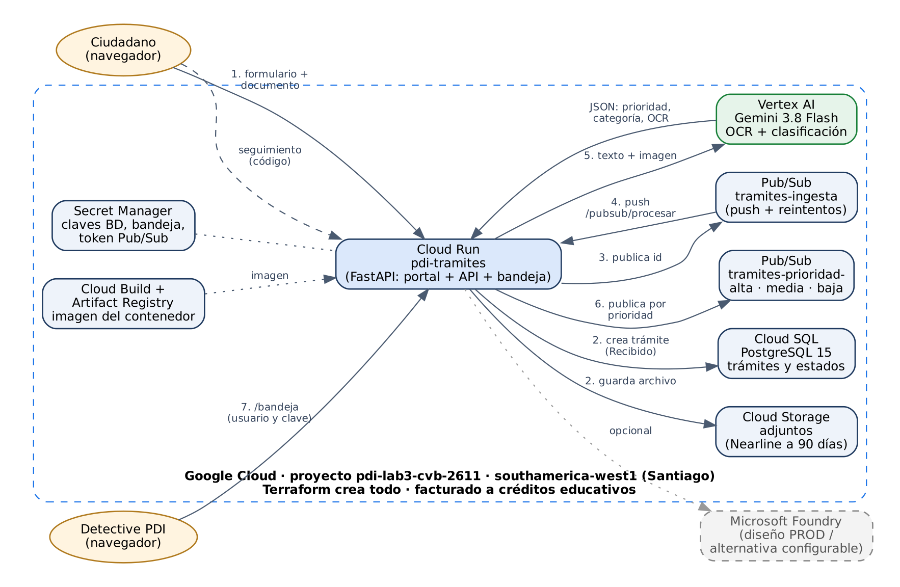

# Laboratorio 3 · Prueba de concepto + Infraestructura como código

**PDI · Canal digital de trámites migratorios** — TICS413 Arquitectura Cloud, UAI
Grupo: Jorge Becerra, Cristian Vergara y Lucas Molina

Esta prueba de concepto implementa en Google Cloud (región Santiago) el flujo diseñado en los laboratorios 1 y 2: el ciudadano envía su trámite con su documento, el sistema lo guarda, lo encola, lo clasifica con IA (**Gemini en Vertex AI**, con soporte configurable para **Microsoft Foundry**), y los detectives lo revisan en una bandeja ordenada por prioridad. Toda la infraestructura se crea con **Terraform**, sin pasos manuales en la consola.

> **PoC en línea:** https://pdi-tramites-hrd75y4yja-tl.a.run.app · bandeja en `/bandeja` (usuario `detective`; la clave va en el documento de entrega).

## 1. Qué se crea

| Componente | Servicio | Para qué |
| --- | --- | --- |
| App web + API | Cloud Run (`pdi-tramites`) | Formulario del ciudadano, seguimiento, bandeja de detectives y procesamiento |
| Imagen del contenedor | Cloud Build + Artifact Registry | Cloud Build compila la imagen y Artifact Registry la guarda para Cloud Run |
| Adjuntos | Cloud Storage | Cédulas y pasaportes (pasan a Nearline a los 90 días) |
| Cola de trabajo | Pub/Sub | Tópico de ingesta + 3 tópicos por prioridad (Alta, Media, Baja) |
| Base de datos | Cloud SQL PostgreSQL | Trámites, estados, código de seguimiento y resultado de la IA |
| Credenciales | Secret Manager | Clave de la base de datos, de la bandeja y (si se usa) de Azure |
| Identidad | Cuenta de servicio | Permisos mínimos para que Cloud Run use los demás servicios |
| IA | Gemini en Vertex AI (`gemini-3.8-flash`) · alternativa: Microsoft Foundry | Lee el documento (OCR de imagen o PDF) y clasifica el trámite con prioridad |

## 2. Recorrido de un trámite

1. El ciudadano llena el formulario en la URL de Cloud Run y adjunta su documento.
2. Cloud Run guarda el archivo en Cloud Storage, crea el trámite en Cloud SQL (estado **Recibido**) y lo publica en el tópico `tramites-ingesta`.
3. Pub/Sub entrega el aviso a Cloud Run (`/pubsub/procesar`), con reintentos si algo falla.
4. Cloud Run envía el texto y el documento al modelo de IA (Gemini en Vertex AI), que devuelve tipo de documento, texto OCR, categoría, prioridad y resumen.
5. El trámite queda **Clasificado** en Cloud SQL y se publica en `tramites-prioridad-alta`, `-media` o `-baja`.
6. El ciudadano ve el estado con su enlace de seguimiento (código aleatorio, sin datos personales).
7. El detective entra a `/bandeja` (usuario y clave), ve los trámites ordenados por prioridad y cambia su estado a **En revisión** o **Resuelto**.

**Simplificaciones de la prueba de concepto** (respecto del diseño de PROD del Lab 2):
- El correo con Microsoft Graph se reemplaza por un formulario web, porque no tenemos acceso a la casilla de la PDI ni permisos de administrador de Microsoft 365. El resto del flujo es el mismo.
- Backend y portal van en un solo servicio de Cloud Run (en PROD son dos: `pdi-backend-api` y `pdi-web-portal`).
- Cloud SQL es zonal y `db-f1-micro` (en PROD es regional con alta disponibilidad). No tiene redes autorizadas: solo se accede con el conector de Cloud SQL de Cloud Run.
- La bandeja usa usuario y clave en vez del inicio de sesión con Entra ID.
- **IA:** el diseño de PROD usa Microsoft Foundry (Azure OpenAI). El recurso Foundry que entregó el curso fue dado de baja antes de la entrega, así que la PoC usa **Gemini en Vertex AI**, que se cobra a los mismos créditos educativos de GCP y no necesita claves (Cloud Run se autentica con su cuenta de servicio, rol `aiplatform.user`). El código soporta los dos motores: con `./scripts/configurar_ia.sh` se cambia a Foundry sin tocar nada más. Si la IA falla, el trámite no se pierde: se clasifica con reglas simples y queda marcado.

## 3. Requisitos

- Un proyecto de GCP con facturación (créditos educativos) y rol **Propietario**.
- Nada más para la IA: Vertex AI se habilita solo con Terraform. (Opcional: un recurso de Microsoft Foundry con un modelo desplegado, si se quiere usar Foundry en vez de Gemini.)
- **Cloud Shell** (ya trae `gcloud`). Si no tiene Terraform, `desplegar.sh` lo instala solo en `~/bin`.

> Con `vertex_model = ""` y sin clave de Azure la app igual funciona, pero clasifica con reglas simples («modo simulado»).

## 4. Despliegue paso a paso

1. Abre [Cloud Shell](https://shell.cloud.google.com/) con la cuenta que tiene acceso al proyecto.
2. Sube esta carpeta (menú ⋮ → **Subir** → el `.zip`) y descomprímela:
   ```bash
   unzip pdi-lab3.zip && cd pdi-lab3
   ```
3. Crea el archivo de variables y pon el ID del proyecto:
   ```bash
   cp terraform/terraform.tfvars.example terraform/terraform.tfvars
   nano terraform/terraform.tfvars      # Ctrl+O para guardar, Ctrl+X para salir
   ```
4. Despliega todo:
   ```bash
   ./scripts/desplegar.sh
   ```
   Toma unos 10 a 15 minutos (Cloud SQL es lo más lento). Al final muestra la URL de la app, la de la bandeja y la clave del detective.
   Si en un proyecto recién creado falla por permisos (`PERMISSION_DENIED`, los permisos nuevos tardan unos minutos en propagarse), espera 1 minuto y vuelve a correr el mismo comando: Terraform continúa desde donde quedó.
5. *(Opcional)* Cambiar la IA a Microsoft Foundry (pide endpoint, implementación y clave; la clave no se ve al pegarla).
   El script prueba que el modelo responda antes de guardar nada, y luego redespliega:
   ```bash
   ./scripts/configurar_ia.sh
   ```
   - Endpoint: en Foundry → tu proyecto → **Inicio** («Punto de conexión de Azure OpenAI»).
   - Implementación: el nombre del modelo desplegado (pestaña **Modelos e implementaciones**).
   - La clave queda en Secret Manager; `terraform.tfvars` no se sube a GitHub.
6. Pruebas automáticas de punta a punta y de errores (18 verificaciones: flujo completo, Pub/Sub, 401, 404, 413, 422…):
   ```bash
   ./scripts/pruebas_e2e.sh
   ```

## 5. Cómo probar la prueba de concepto

1. Abre la **URL de la app** y envía un trámite con una foto de cédula o pasaporte (puede ser un documento de ejemplo).
2. Copia el **enlace de seguimiento**: en unos segundos el estado pasa de *Recibido* a *Clasificado*.
3. Entra a **/bandeja** con usuario `detective` y la clave que mostró el despliegue (`terraform -chdir=terraform output -raw bandeja_clave`).
4. Abre el trámite: verás la prioridad, la categoría, el resumen y el texto leído por la IA y el motor usado (modelo y segundos que tardó). Cambia el estado a *En revisión* y vuelve al enlace de seguimiento para ver el cambio.
5. En la consola de GCP puedes mostrar cada pieza: Cloud Run (registros), Cloud Storage (el adjunto), Pub/Sub (suscripciones `tramites-prioridad-*-bandeja`) y Cloud SQL.

## 6. Borrar todo al terminar

```bash
./scripts/destruir.sh
```
Elimina Cloud Run, Cloud SQL, el bucket, Pub/Sub, los secretos y la cuenta de servicio, para no seguir gastando créditos.

## 7. Costo de la prueba

Todo se cobra a la cuenta de facturación con créditos educativos (USD 50). Valores aproximados en `southamerica-west1`:

| Servicio | Costo aproximado | Comentario |
| --- | --- | --- |
| Cloud SQL `db-f1-micro` + 10 GB SSD | ≈ USD 0,40 al día | Lo único que cobra aunque nadie use la app |
| Cloud Run | ≈ USD 0 | Escala a cero; capa gratuita de 2 millones de solicitudes al mes |
| Gemini 3.8 Flash (Vertex AI) | < USD 0,01 por trámite | Unos pocos miles de tokens por trámite, imagen incluida |
| Pub/Sub, Secret Manager, Storage, Artifact Registry | ≈ USD 0 | Dentro de la capa gratuita con este volumen |
| Cloud Build | ≈ USD 0 | 2 compilaciones de ~1 min por despliegue; 120 min gratis al día |

**Total para tener la PoC encendida 3 días con ~100 trámites de prueba: alrededor de USD 1,5.** Al terminar, `./scripts/destruir.sh` deja el costo en cero.

## 8. Diagrama final



## 9. Lecciones aprendidas

- **Infraestructura como código:** el mismo `desplegar.sh` se corrió varias veces mientras corregíamos errores; Terraform solo crea lo que falta, así que reintentar es seguro y cada arreglo quedó en el código, no en clics de la consola.
- **Dependencias de una nube nueva:** un proyecto recién creado no deja habilitar APIs hasta habilitar Cloud Resource Manager; y Cloud Build necesita permisos explícitos para subir la imagen. Ambos quedaron automatizados.
- **Construir la imagen en la nube:** con `docker build` en Cloud Shell la descarga de la imagen base demoraba más de 5 minutos y terminó en error; con Cloud Build tarda ~1 minuto.
- **Proveedor de IA:** el recurso de Microsoft Foundry del curso fue dado de baja antes de la entrega. Como la IA estaba aislada en una función con un contrato JSON fijo, cambiar a Gemini en Vertex AI fue agregar un motor, sin tocar el resto. Además, Vertex no necesita claves: Cloud Run usa su cuenta de servicio.
- **Diseño a prueba de fallas:** si la IA no responde, el trámite no se pierde (se clasifica con reglas y queda marcado), y Pub/Sub reintenta la entrega si Cloud Run falla.
- **Seguridad mínima viable:** secretos en Secret Manager, bucket sin acceso público, Cloud SQL sin IP autorizadas, token en el push de Pub/Sub y bandeja con autenticación (probado: 401 y 403).

## 10. Estructura del repositorio

```
app/          Código de la aplicación (FastAPI) y su Dockerfile
terraform/    Infraestructura como código (main.tf, variables.tf, outputs.tf)
scripts/      desplegar.sh · configurar_ia.sh · pruebas_e2e.sh · prueba.sh · destruir.sh · generar_ejemplo.py
ejemplos/     documento_ejemplo.png (documento ficticio para probar el OCR)
docs/         diagrama_final.png / .svg / .dot
```

Para correr la app en un computador sin nube: `cd app && pip install -r requirements.txt && uvicorn main:app --reload` (usa SQLite, una carpeta local y clasificación simulada).
